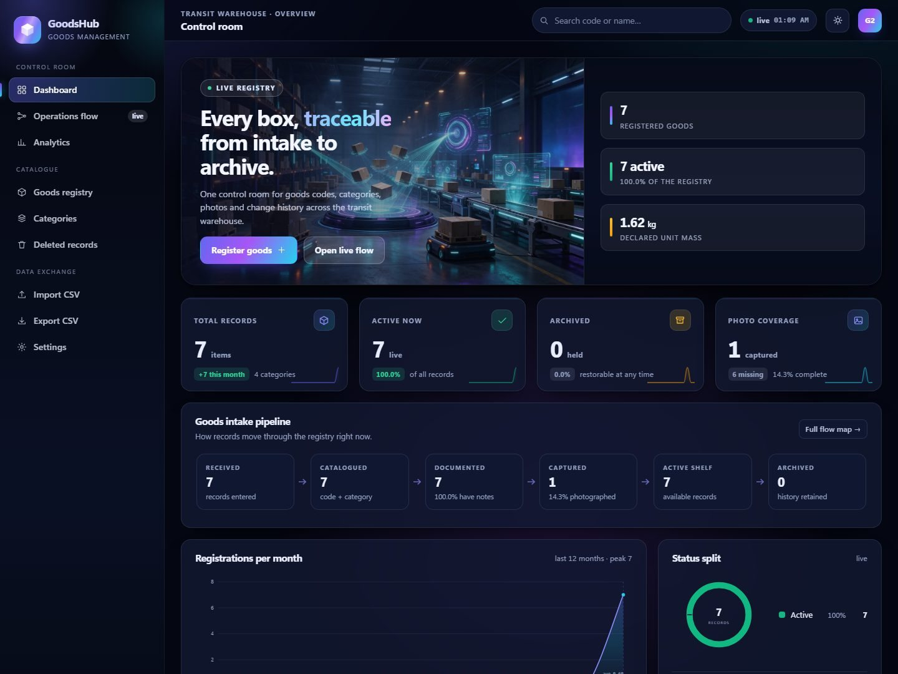
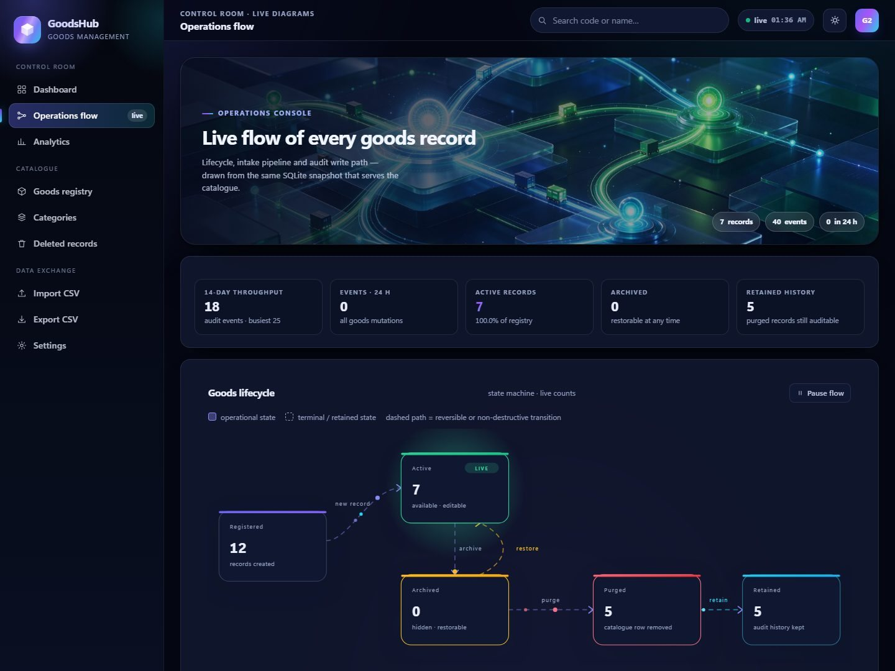
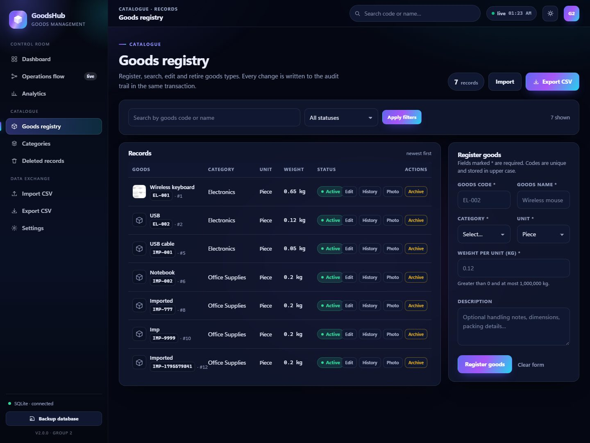
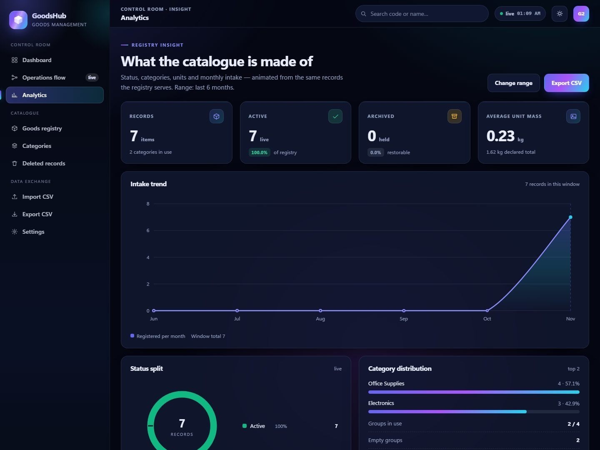
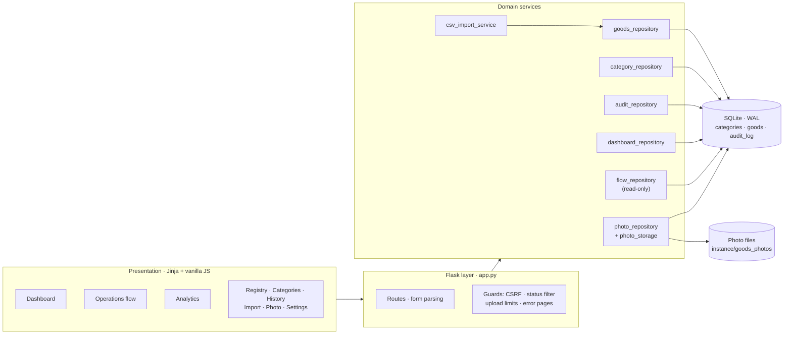
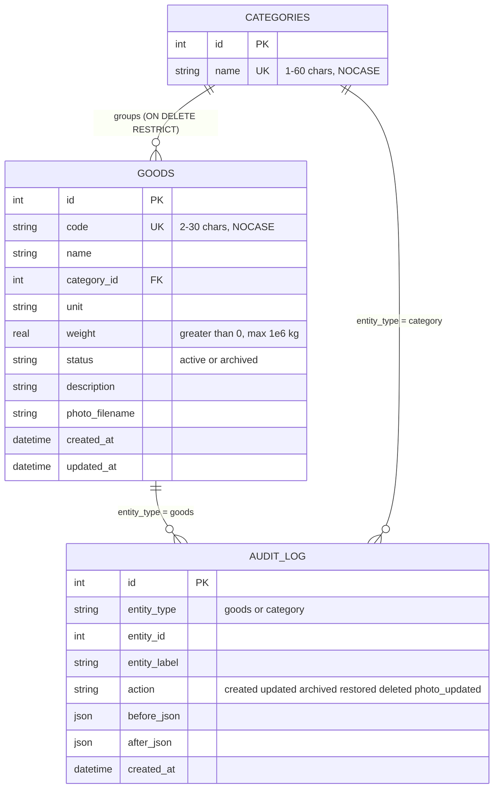

<div align="center">
  
</div>

<h1 align="center">GoodsHub</h1>

<p align="center">
  <b>A goods registry and live operations console for a logistics transit warehouse.</b><br>
  <sub>Catalogue integrity, audit-complete lifecycle, and process diagrams that animate from real data.</sub>
</p>

<p align="center">
  
  
  
  
  
</p>

---

## Overview

GoodsHub manages the **goods types** that pass through a transit warehouse: what they are called, which category they belong to, how they are counted and weighed, what they look like, and every change ever made to them. Record counts are catalogue entries — this module deliberately does not model stock quantities, which belong to the inventory modules around it.

Most course prototypes stop at CRUD. This one treats the registry as a **system with state**: goods move through `Active → Archived → Purged` (with `Restored` going back), each transition is written to an append-only audit log inside the same transaction as the data change, and the whole process is rendered as **live SVG diagrams** that read their counts from the same snapshot the tables do.

| | |
|---|---|
| **Domain** | Goods Management module — Group 2, Software Design & Architecture |
| **Stack** | Python 3.13 · Flask 3.1 · SQLite (WAL) · Pillow |
| **Front end** | Jinja templates, hand-written CSS token system, dependency-free SVG charts — no bundler, no CDN |
| **Persistence** | `instance/goodshub.sqlite3`, photo files on disk, JSON settings |
| **Runs on** | Windows / macOS / Linux, single process, no external services |

---

## Interface



<sub><b>Control room</b> — registry health, intake pipeline, intake trend, status and category splits, activity heatmap and a live event stream, all from one SQLite snapshot.</sub>

<table>
  <tr>
    <td width="33%" valign="top"></td>
    <td width="33%" valign="top"></td>
    <td width="33%" valign="top"></td>
  </tr>
  <tr>
    <td valign="top"><sub><b>Operations flow</b><br>registered → active → archived → purged → retained, drawn live from the same records.</sub></td>
    <td valign="top"><sub><b>Goods registry</b><br>search, filter, inline status actions and a sticky registration form.</sub></td>
    <td valign="top"><sub><b>Analytics</b><br>intake trend, status split, category mix and record completeness.</sub></td>
  </tr>
</table>

<sub>The remaining screens — audit history, CSV import, categories, purge log, settings and the light theme — are in [`docs/screenshots`](docs/screenshots). All captures use reduced motion so the final state is frozen; at runtime charts draw in, counters count up and diagram particles keep flowing.</sub>

---

## What it does

**Registry**
- Register, edit, search and filter goods by code or name, across active and archived records.
- Categories with case-insensitive uniqueness, rename-in-place, and deletion refused while any goods — archived included — still reference them.
- Unit-of-measure and weight validation shared by the form, the API and the importer.

**Lifecycle and audit**
- Archive and restore; permanent deletion only from the archived state, behind an explicit confirmation step.
- Every mutation writes a before/after snapshot to `audit_log` in the **same transaction** as the row change.
- Deleted goods disappear from the catalogue but their history stays readable forever.

**Bulk and media**
- CSV import with header contract checking, per-row validation and duplicate protection — valid rows commit, invalid rows report and never roll back the batch.
- Filter-aware CSV export with spreadsheet-injection guards.
- Photo upload: format, size and pixel-area checks, re-encode to JPEG, generated filenames, thumbnail serving, old-file cleanup after commit.

**Observability**
- `/flow` renders three process diagrams from live SQL counts.
- `/api/live` powers 6-second in-place counter updates; `/api/ops` exposes the full operations snapshot as JSON.

---

## Architecture



Three ideas hold the design together:

1. **One writer per rule.** Validation lives in the repositories, not in the views, so the form, the CSV importer and any future API all inherit identical rules.
2. **One transaction per mutation.** The goods row and its audit entry commit or fail together — history can never disagree with the catalogue.
3. **Read models are separate.** `dashboard_repository` and `flow_repository` only read; the interface can be rebuilt or replaced without touching a single business rule.

---

## Data model



`audit_log` is append-only and intentionally not foreign-keyed to `goods`: a purged record must remain traceable, so the log stores its own label and JSON snapshots. The `goods → categories` foreign key is `RESTRICT`, which is what makes "you cannot delete a category that is in use" a database truth rather than a UI opinion.

---

## Live endpoints

| Endpoint | Purpose | Shape |
|---|---|---|
| `GET /flow` | Operations console with the three animated diagrams | HTML |
| `GET /api/live` | Counters for the polling layer (totals, active, archived, 24 h events) | JSON |
| `GET /api/ops` | Full operations snapshot: counts, ratios, mass, action mix, lifecycle, pipeline, 14-day matrix | JSON |
| `GET /goods/export` | Filter-aware CSV export (`q`, `status`) | `text/csv` |
| `GET /goods/import/template` | Download import template | `text/csv` |

Both JSON endpoints are read-only and reuse the same connection policy as the pages, so they cannot drift from what the UI shows.

---

## Interface system

- **Tokens, not ad-hoc colours.** One `:root` layer defines surfaces, text, borders and accents for light and dark; components consume variables only.
- **Charts without a library.** `charts.js` draws area, donut, bar and sparkline charts as SVG from JSON declared in the page, with draw-in animation, hover tooltips and legend linking.
- **Motion with a purpose.** Reveal-on-scroll, count-up figures, a 6-second live pulse, and SVG path particles; every animation is disabled under `prefers-reduced-motion`.
- **Accessible by default.** Skip link, labelled controls, focus-visible rings, keyboard-closable dialogs, and a print stylesheet that drops the chrome.

---

## Quick start

```powershell
git clone <your-repo-url>
cd Goods_Management

py -3.13 -m venv .venv
.\.venv\Scripts\python.exe -m pip install -r requirements.txt
.\.venv\Scripts\python.exe -m flask --app app run
```

Open <http://127.0.0.1:5000/>. The database, photo folders and settings file are created under `instance/` on first run; start from **Categories**, then register or import goods.

<sub>macOS / Linux: replace the interpreter path with <code>.venv/bin/python</code>.</sub>

---

## CSV import

```csv
code,name,category,unit,weight,description
IMP-001,USB cable,Electronics,Piece,0.05,One metre cable
IMP-002,Notebook,Office Supplies,Piece,0.20,A5 notebook
```

| Rule | Behaviour |
|---|---|
| Categories | must already exist, matched by name |
| Codes | unique, 2–30 chars, stored upper-case |
| Units | `Piece · Box · Pack · Bag · Bottle · Set · Roll` |
| Weight | `> 0` and `≤ 1,000,000 kg` |
| Batch | max 500 goods / 2 MB, UTF-8 (BOM tolerated) |
| Duplicates | skipped, never overwritten |
| Failures | isolated per row, with a message and line number |

---

## Business rules

| Rule | Enforced by |
|---|---|
| Goods must be archived before permanent deletion | repository + route guard |
| Permanent deletion keeps the audit history | append-only `audit_log` |
| Categories in use cannot be deleted | SQL `ON DELETE RESTRICT` + repository check |
| A mutation and its audit entry are atomic | single `BEGIN IMMEDIATE` transaction |
| Deletion needs explicit confirmation | form contract (`confirmation=delete`) |
| Dashboard totals count records, not stock | read model definition |

---

## Project layout

```
Goods_Management/
├── app.py                  # routes, CSRF, form parsing, security headers, error pages
├── database.py             # connections, schema bootstrap, WAL, backups
├── goods_repository.py     # validation, storage, lifecycle
├── category_repository.py  # categories + deletion protection
├── audit_repository.py     # history retrieval, change diffs, deleted records
├── dashboard_repository.py # summary counts, recent registrations
├── photo_repository.py     # photo column + photo change logging
├── photo_storage.py        # image validation, resize, thumbnails
├── csv_import_service.py   # CSV parsing and row-by-row import
├── flow_repository.py      # read-only operations snapshot
├── templates/              # layout, macros, and one template per page
├── static/
│   ├── css/app.css         # design system: tokens, layout, components, motion
│   ├── js/charts.js        # SVG chart engine
│   ├── js/app.js           # theme, nav, reveal, polling, dialogs, dropzones
│   └── img/                # logo artwork and generated illustration set
├── instance/               # database, photos, settings, backups (runtime)
└── docs/                   # SRS, UML, architecture notes, screenshots
```

---

## Documentation

| Document | Contents |
|---|---|
| [SRS](docs/SRS.md) | functional and non-functional requirements, use cases |
| [Project proposal](docs/project_proposal.md) | scope, stakeholders, success criteria |
| [Architecture & database](docs/Architecture_and_Database.md) | layering, schema decisions, transaction strategy |
| [UML](docs/UML_Diagrams.md) | use case, class, sequence, activity, component |
| [Diagram set](docs/GoodsHub_Diagrams/index.html) | all diagrams as SVG / PNG with sources |
| [Testing report](docs/Testing_Report.md) | test matrix and results |
| [Screens](docs/screenshots) | interface captures — every page, dark and light |

---

## Scope

**In scope** — goods types, categories, lifecycle (archive / restore / purge), audit trail, photos, CSV import/export, dashboards and process observability.

**Out of scope, by design** — authentication and roles, stock quantities, bin allocation, inbound receiving, outbound dispatch, shipment tracking. Those belong to the neighbouring modules of the same transit warehouse system and appear in the diagrams as adjacent processes.

**Possible next steps** — role-based access with per-user audit attribution, scheduled exports, a REST API over the same repositories, and WebSocket push in place of polling.

---

<p align="center">
  <b>Group 2</b> — Software Design &amp; Architecture course project<br>
  <sub>Built with Flask, SQLite and a lot of hand-written SVG.</sub>
</p>
