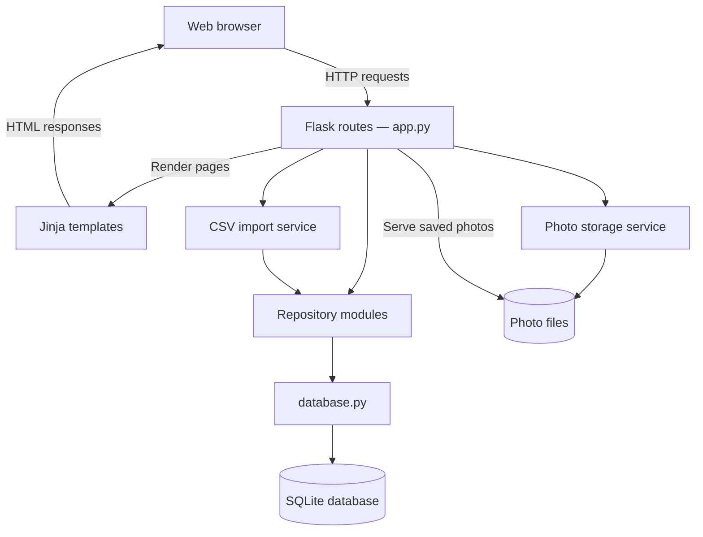
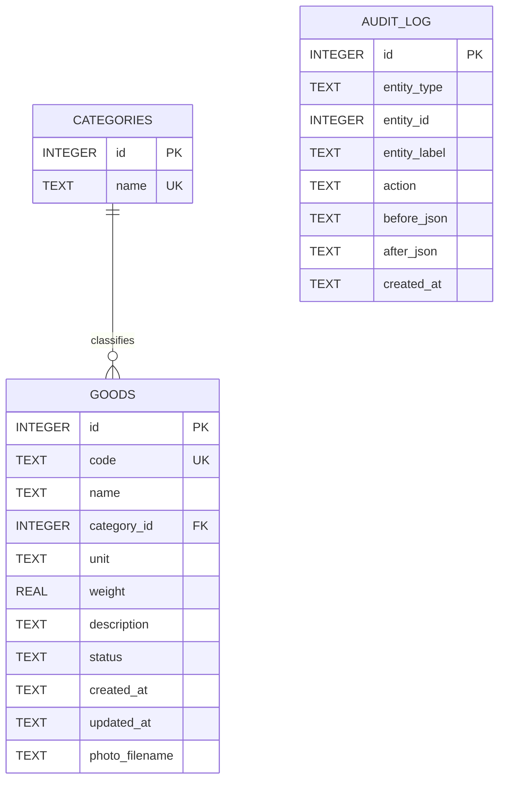

# GoodsHub — Architecture and Database Design

Course: Software Design and Architecture
Team: Group 2
Module: Goods Management

## 1. Architecture Overview

GoodsHub is a modular monolithic web application.

It runs as one Flask application, with responsibilities separated into
routes, templates, processing services, and database-access modules.

The application uses a layered organization, although business validation
and SQL operations are combined in repository modules. It does not have
a separate business-service layer for every operation.

## 2. Architecture Diagram

The diagram summarizes the main runtime paths.
At startup, app.py also initializes the database and photo column.

CSV export is currently implemented directly in app.py.

## 3. Component Responsibilities

| Component | Responsibility |
|---|---|
| app.py | Handles HTTP requests, validates form tokens, coordinates operations, and renders responses. |
| templates/ | Presents forms, tables, dashboard information, photos, and audit history. |
| goods_repository.py | Validates goods and performs registration, editing, searching, status changes, and deletion. |
| category_repository.py | Creates, renames, and deletes categories with usage protection. |
| audit_repository.py | Retrieves goods history and information about deleted goods. |
| dashboard_repository.py | Reads summary counts and the five most recently registered goods. |
| csv_import_service.py | Parses CSV files and imports rows using the goods repository. |
| photo_storage.py | Validates images, resizes them, and saves generated JPEG files. |
| photo_repository.py | Adds the photo column when needed and records photo-reference changes. |
| database.py | Creates database tables and opens connections with foreign-key enforcement. |

Repository modules that change data write their audit entries directly
in the same database transaction. They do not call audit_repository.py
to write history; that module retrieves history.

## 4. Design Decisions

### 4.1 Separation of Responsibilities

Templates handle presentation.
Routes handle web requests and coordinate operations.
Repository modules handle validation and database access.
CSV and image processing have separate modules.

This organization makes the application easier to understand and change.

### 4.2 Shared Goods Validation

Manual registration and CSV import both use add_goods().

This keeps validation rules and creation-history behavior consistent
across both entry points.

### 4.3 Transactional Audit Logging

Goods and category changes are saved together with their audit entries.

If an operation fails before commit, the transaction is rolled back.

CSV imports use one transaction per successfully created goods record.
The entire file is not treated as one transaction.

### 4.4 Archive Before Deletion

Archiving supports reversible removal from active use.

Permanent deletion is allowed only after archiving.
The web interface requires explicit confirmation.

### 4.5 Retained History

Audit entries contain JSON snapshots of the previous and new values.

History remains available after the goods record has been deleted.

### 4.6 Photo Storage

Image files are stored on disk.
The goods table stores only the current generated filename.

Image-file storage and SQLite updates are not one atomic transaction.
The upload route attempts to remove a newly saved file if its database
update fails.

Previous photo files are retained when a photo is replaced.

## 5. Database Overview

The SQLite database contains three application tables:

- categories
- goods
- audit_log

Database location: instance/goodshub.sqlite3

## 6. Entity Relationship Diagram

Each goods record belongs to exactly one category.
A category can contain zero or more goods records.

audit_log is intentionally shown without a foreign-key relationship.
Its entity_type and entity_id identify the historical subject logically.
That subject may no longer exist in the live tables.

## 7. Table Definitions

### 7.1 categories

| Column | Purpose |
|---|---|
| id | Auto-incrementing primary key. |
| name | Required category name, unique using SQLite NOCASE comparison, with a trimmed length of 1–60 characters. |

### 7.2 goods

| Column | Purpose |
|---|---|
| id | Auto-incrementing primary key. |
| code | Required unique goods code, 2–30 characters. |
| name | Required goods name, with a trimmed length of 1–120 characters. |
| category_id | Required foreign key referencing categories.id. |
| unit | One of the seven allowed unit values. |
| weight | Weight per unit in kilograms; greater than zero and at most 1,000,000. |
| description | Optional description, stored as an empty string by default; maximum 2,000 characters. |
| status | active or archived; defaults to active. |
| created_at | Creation timestamp; defaults to SQLite CURRENT_TIMESTAMP. |
| updated_at | Last update timestamp; initialized at creation and updated by application operations. |
| photo_filename | Current photo filename; empty when no photo has been uploaded. |

The photo_filename column is added by initialize_photo_column()
during application startup if it is missing.

### 7.3 audit_log

| Column | Purpose |
|---|---|
| id | Auto-incrementing primary key identifying an event. |
| entity_type | goods or category. |
| entity_id | ID of the affected entity; deliberately not a foreign key. |
| entity_label | Goods code or category label associated with the event. |
| action | Event name, such as created, updated, archived, restored, deleted, renamed, or photo_updated. |
| before_json | Snapshot before the operation; NULL for creation. |
| after_json | Snapshot after the operation; NULL for deletion. |
| created_at | Event timestamp; defaults to SQLite CURRENT_TIMESTAMP. |

JSON snapshots are stored as TEXT.

The application displays relevant business-field differences between
snapshots on the goods history page.

## 8. Relationships and Constraints

### 8.1 Category Relationship

goods.category_id references categories.id.

The foreign key uses ON DELETE RESTRICT.
The application also checks category usage and presents a readable error.

Both active and archived goods prevent category deletion.

### 8.2 Uniqueness

Category names and goods codes have unique constraints using SQLite
NOCASE comparison.

SQLite's built-in NOCASE comparison handles ASCII letter case.
It does not provide complete Unicode case folding.

### 8.3 Indexes

The schema creates:

- idx_goods_category on goods.category_id
- idx_goods_status on goods.status

Primary-key and unique constraints also provide supporting indexes
according to SQLite's implementation.

### 8.4 Audit Independence

audit_log.entity_id has no foreign key to goods or categories.

Deleting a live entity therefore does not remove its history.
Historical values are preserved in the JSON snapshots.

## 9. Example Operation: Register Goods

1. The browser submits the registration form.
2. app.py validates the CSRF token and reads the form fields.
3. add_goods() validates the supplied goods data.
4. The repository checks that the category exists.
5. The goods record is inserted.
6. A Created audit entry is inserted in the same transaction.
7. The transaction commits.
8. The route redirects to the goods list.

If validation fails, the user receives an error message.
If a database operation fails before commit, the transaction rolls back.

## 10. Deployment and Boundaries

For the classroom demonstration, the browser and Flask application
run on the same computer.

SQLite and photo files are stored locally.

The current prototype has no authentication service, stock-management
service, or shipment service.

Integration with other warehouse modules would require agreed interfaces,
shared identifiers, and additional rules for deleting referenced goods.
These integrations are not implemented in this version.

## 11. Limitations

- Business validation and SQL are combined in repository modules.
- app.py contains routes and CSV export logic.
- There is no implemented role-based access control.
- Photo files and database records are not committed atomically.
- Old photo files are retained without automatic cleanup.
- Audit records do not identify the person who performed an operation.
- Audit history is application-maintained, not a tamper-proof log.

## 12. Relationship to UML Deliverables

The architecture diagram and ER diagram explain application structure
and database relationships.

The required Use Case, Class, Sequence, Activity, and Component diagrams
will be documented separately.