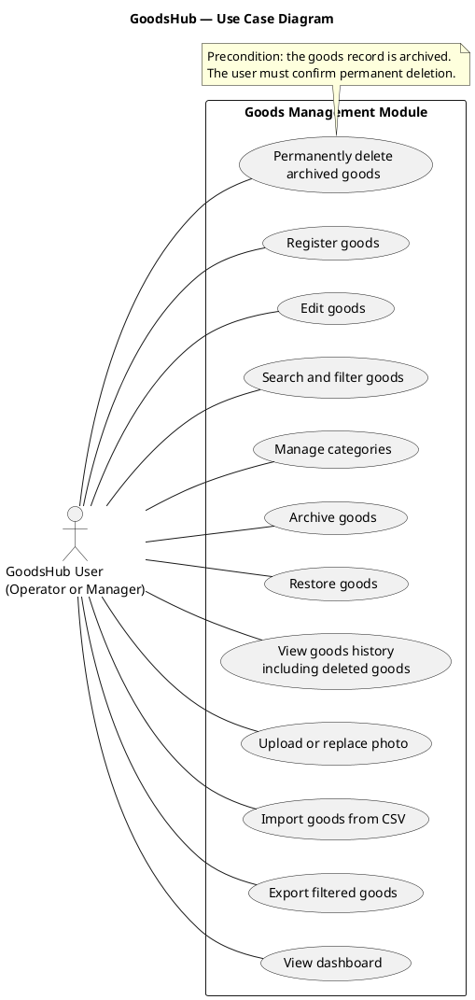
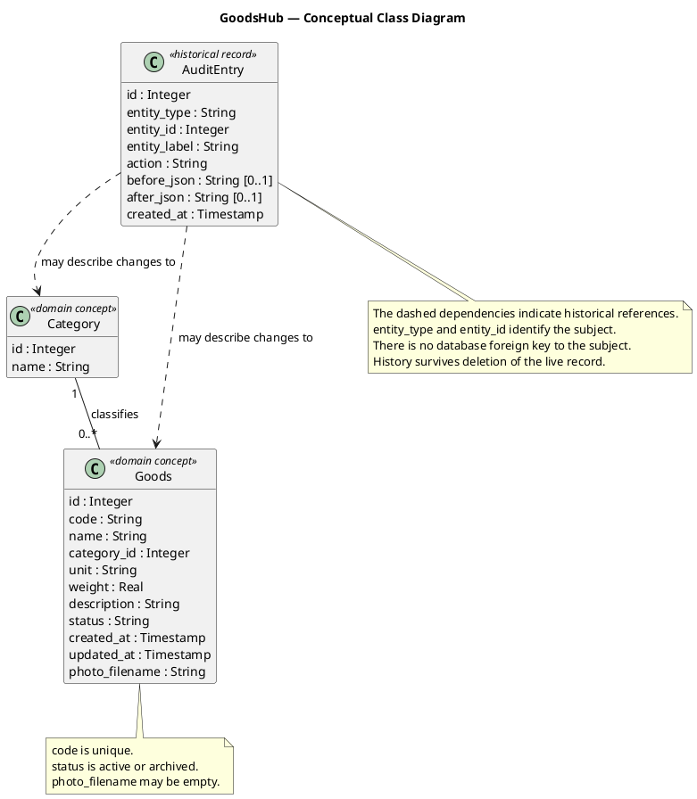
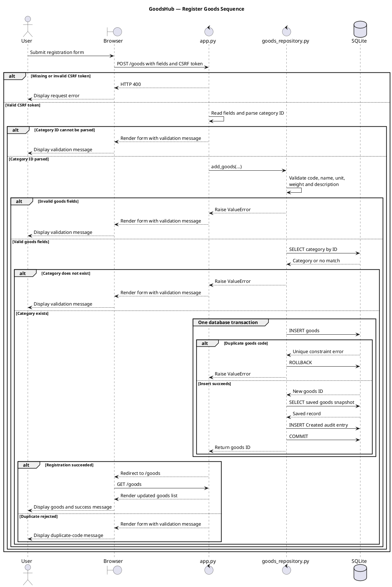
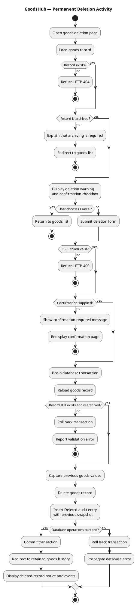
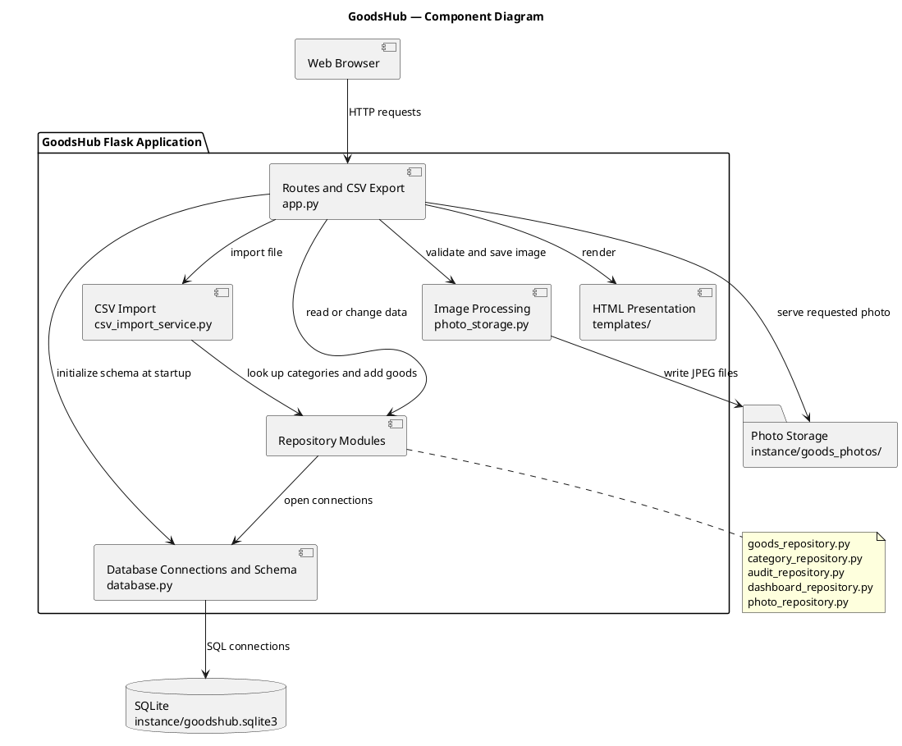

# GoodsHub — UML Diagrams

Course: Software Design and Architecture
Team: Group 2
Module: Goods Management

## 1. Use Case Diagram

This diagram describes the actions available to a GoodsHub user.

The prototype has no login or role-based permissions. Operators and
managers can use the same interface; their business responsibilities
do not restrict access in the current implementation.

“Manage categories” includes creating, renaming, and deleting unused
categories. Audit logging is an internal responsibility rather than
a separate user action.

## 2. Class Diagram — Conceptual Domain Model

This diagram models the domain concepts.

The current Python implementation uses functions, SQLite rows, and
dictionaries. It does not define Python classes named Goods, Category,
or AuditEntry. These are conceptual classes used to explain the data.

The category relationship is a normal association, not composition:
deleting a category does not automatically delete its goods.

## 3. Sequence Diagram — Register Goods

This diagram shows successful registration and important error paths.

The SQLite participant abstracts the connection obtained through
database.py. Template rendering is summarized in the HTTP responses.

The diagram highlights the normal and validation paths. Other database
failures before commit also cause the transaction to roll back.

## 4. Activity Diagram — Permanent Goods Deletion

This diagram describes the web deletion workflow.

The repository rechecks the goods record and its status inside the
transaction before deleting it.

Archiving is a separate operation. It is a precondition for deletion,
not an automatic step performed by the deletion page.

## 5. Component Diagram

This diagram shows the main implementation modules and their
dependencies.

The repositories are grouped to keep the diagram readable.

The browser receives HTML rendered through Flask and Jinja.

Repository functions that mutate goods or categories also insert their
audit entries. audit_repository.py is responsible for retrieving
history, not writing every audit event.

## 6. Traceability to Requirements

| Diagram | Main requirements explained |
|---|---|
| Use Case | FR-01 through FR-14: user-visible functions |
| Conceptual Class | Goods, categories, and audit-history data concepts |
| Registration Sequence | FR-01, FR-02, FR-09: registration, uniqueness, and audit creation |
| Deletion Activity | FR-08, FR-10: confirmed deletion and retained history |
| Component | Maintainability and separation of implementation responsibilities |

## 7. Diagram Interpretation

- The diagrams describe the implemented Goods Management scope.
- Business roles are not enforced access-control roles.
- The conceptual class diagram does not claim that corresponding
  Python classes already exist.
- Historical audit references are not database foreign keys.
- SQLite and image files are separate storage mechanisms.
- Other warehouse modules are outside this implementation.